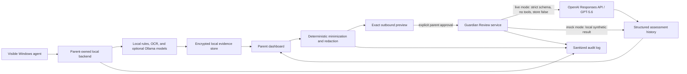

# Historical GuardianNode Build Week README

Archived from the root README on November 14, 2026. This record describes the earlier Build Week scope; it does not qualify the current screenshot and AI-review edition. Original commits, tags and validation records remain intact.

## Historical Build Week 2026

The following records describe the earlier Build Week work. They are preserved
for provenance and do not establish qualification or scope for this edition.


### What GuardianNode is

GuardianNode is the existing local-first foundation described above: a visible
Windows agent, parent-owned backend, local detection pipeline, encrypted
evidence store, and parent dashboard. It creates reviewable safety signals while
keeping normal operation local and under the parent's control.

### What Guardian Review adds

Guardian Review is the Build Week optional second opinion for an existing local
alert. A parent can add context, inspect the exact
locally minimized/redacted JSON proposed for transmission, consent to that one
request, and receive a strict structured assessment with uncertainty,
conversation guidance, actions, escalation indicators, and limitations.

The backend service, durable worker, strict schema, direct OpenAI Responses API
integration, and synthetic harness were implemented on July 14. The alert page
then gained guided minimization controls, an exact read-only outbound preview,
explicit consent and cancel actions, a complete communication plan, local
review history/deletion, and versioned parent feedback. Six resettable judge
scenarios and a 55-case evaluation set use synthetic data only. Guardian Review
does not silently upload screenshots or directly drive enforcement.

### Existing-project disclosure

The last verified repository state before the official Build Week cutoff is
commit `36b2a547056d40eff32f00aa59b7820f7d3e98d5`, protected by tag
`pre-build-week-2026`. Guardian Review was developed on the
`build-week/guardian-review` and `build-week/guardian-review-privacy` branches;
the qualified Build Week result and its release evidence are merged into
`main`. The pre-existing project includes the agent, backend, dashboard, local
detection, encrypted evidence, installers, authentication/security controls,
and 353 passing unique tests.

The repository owner describes the existing dashboard/visual UI as
Claude-assisted and the existing agent, backend, security, installer, and
platform hardening as Codex-built. Git metadata cannot independently verify the
complete historical split. See the [baseline evidence](../../docs/build-week/BASELINE.md)
and the [Build Week comparison](https://github.com/the-vibe-dev/guardiannode/compare/pre-build-week-2026...main).

### How Codex is being used

Codex is being used to preserve and audit the baseline, trace the actual
application flow, run verification, define the Guardian Review schema/privacy
contract, and implement reviewed Build Week changes. No production child data
is used for this collaboration. Details are recorded in the
[collaboration log](../../docs/build-week/CODEX_COLLABORATION.md).

GPT-5.6-powered Codex accelerated repository analysis, implementation, testing,
adversarial review, and submission preparation. Human decisions remained
explicit: cloud review is optional, consent is bound to the exact preview,
feedback remains local, model output cannot punish or diagnose, and the
coding-agent provider was disabled when its tool boundary proved unsuitable.

### How GPT-5.6 is used at runtime

Live Guardian Review uses the server-side OpenAI Responses API, defaults to the
configurable `gpt-5.6` alias, sets `store: false`, supplies no tools, and accepts
only strict schema `1.1.0` output. Deterministic redaction contract
`guardian-review-redaction-v3` and the parent's consent are bound to the exact
outbound preview. `store: false` is not described as a zero-retention guarantee;
live direct-API mode also fails closed unless the operator confirms the project
has approved Zero Data Retention controls.

An experimental “Sign in with ChatGPT” Codex transport was tested using only
synthetic data. The July 18 security review found that a coding agent's local
tools create the wrong capability boundary for family incident evidence, so
that transport is disabled pending enforceable zero-tool isolation. Mock mode
and all local detection remain functional without a live provider.
See the [technical specification](../../docs/build-week/GUARDIAN_REVIEW_SPEC.md)
and [privacy model](../../docs/build-week/PRIVACY_MODEL.md). Reproducible evidence is
in the [evaluation results](../../docs/build-week/EVALUATION_RESULTS.md),
[Build Week changelog](../../docs/build-week/CHANGELOG.md), and
[Codex collaboration record](../../docs/build-week/CODEX_COLLABORATION.md).

### Architecture and privacy flow



Local detection and evidence persistence happen before Guardian Review and do
not depend on an external provider. Screenshots remain local. Only the exact
minimized JSON shown in the preview is eligible for a live request, and a
cancel action sends nothing. See the full [data-flow and privacy model](../../docs/build-week/PRIVACY_MODEL.md).

### Demo mode

Use the Windows 11 installer path below for a technical-parent alpha setup, or
use the source instructions for development. The current demonstrable path is:

1. Start the local backend, complete parent setup, and enable demo mode.
2. Open **Synthetic demo** and confirm the demo device and provider status.
3. Choose one of six labeled synthetic scenarios and trigger its local event.
4. Open the generated incident and review the local detector reasoning.
5. Choose optional context/evidence, inspect the exact outbound JSON, and either
   cancel or explicitly consent.
6. View the structured assessment and communication plan, record local parent
   feedback, then reset the synthetic demo.

For the implemented synthetic backend demonstration:

```bash
cd backend
python -m app.guardian_review_harness --provider mock --scenario unknown-contact
```

For the guided judge path, set `GUARDIANNODE_DEMO_MODE_ENABLED=true` and use the
dashboard's **Synthetic demo** page. Mock mode needs no key. Live mode is an
advanced server configuration; no API key is committed or exposed to the
browser. The coding-agent/ChatGPT subscription transport is intentionally on a
security hold as described above.

See [Guardian Review configuration](../../docs/build-week/CONFIGURATION.md) and
[judge troubleshooting](../../docs/build-week/TROUBLESHOOTING.md). Submission copy
and the functional 2:48 shot plan are in the
[Devpost draft](../../docs/build-week/DEVPOST_DRAFT.md) and
[video script](../../docs/build-week/VIDEO_SCRIPT.md). The
[synthetic screenshot gallery](../../docs/build-week/screenshots/README.md) was
captured from the real disposable mock workflow, not a design mockup.

The recording package includes the [2:48 script](../../docs/build-week/VIDEO_SCRIPT.md),
[Codex computer prompt](../../docs/build-week/video/CODEX_COMPUTER_PROMPT.md),
[production runbook](../../docs/build-week/video/VIDEO_PRODUCTION_RUNBOOK.md), captions,
voiceover, and a machine-readable shot manifest. The final 2:48 recording uses
only labelled synthetic evidence and visibly demonstrates a Windows client,
server-side local detection, exact outbound preview and consent, a live GPT-5.6
Guardian Review, communication guidance, local feedback, and the human decision
boundary. Its qualification record and checksum are in the
[Windows release report](../../docs/release-validation/windows-build-week-2026-07-21.md).

### Live mode

Live mode is an advanced backend-only configuration. It requires an OpenAI API
project explicitly approved for the operator's required retention controls, a
server-side key, and deliberate enablement. The browser never receives the key.
See [Guardian Review configuration](../../docs/build-week/CONFIGURATION.md). The
ChatGPT/Codex subscription transport is intentionally unavailable in this
candidate; it is not a parent-friendly replacement for the direct API yet.

### Tests and evaluation

The latest practical Linux source run recorded 416 unique passing automated
tests: 276 backend/E2E, 59 Windows-agent unit tests, 62 release/control tests,
and 19 dashboard tests. Lint, type checks, production builds, dependency audits,
repository controls, a 196-case rules benchmark, strict documentation build,
and tracked-history secret scanning also passed. A final targeted submission and
release-documentation run added 40 passing tests. See the exact final results and
environment in the [July 21 report](../../docs/build-week/DAILY_2026-07-21.md).

The 55-case Guardian Review evaluation is wholly synthetic and checks explicit
properties. Mock mode achieved 55/55 schema-compliant completions but only
45.45% assessment-category agreement, which is disclosed rather than presented
as model accuracy. See [evaluation results](../../docs/build-week/EVALUATION_RESULTS.md).

### Supported platforms and limitations

GuardianNode is alpha software, can miss or overstate risks, and can capture
sensitive visible content. Windows 11 x64 is the target child-device path;
Windows 10 has not been promoted. Installers are unsigned, the current TLS and
broker changes require a fresh Windows qualification run, and Guardian Review remains a fallible second
opinion rather than an emergency or diagnostic service. Deterministic
redaction is defense-in-depth rather than a guarantee: unusual international
addresses, novel obfuscation, image-only private data, or relevant URL domains
can still carry identifying context. The 55-case synthetic evaluation measures
explicit properties, not clinical or universal accuracy. Earlier Windows 11
installers were qualified with synthetic data, but that evidence does not
qualify this changed build. Windows 10 and current-build qualification, code signing, a
complete clean uninstall/reinstall cycle, and unattended local Ollama recovery
remain before general beta promotion. See [Known limitations](../../KNOWN_LIMITATIONS.md),
the [Windows release report](../../docs/release-validation/windows-build-week-2026-07-21.md),
the [evaluation results](../../docs/build-week/EVALUATION_RESULTS.md), and the
[submission checklist](../../docs/build-week/SUBMISSION_CHECKLIST.md).

### Build Week commits and evidence

- Baseline tag: [`pre-build-week-2026`](https://github.com/the-vibe-dev/guardiannode/tree/pre-build-week-2026)
- Frozen Build Week release: [`guardian-node-build-week-2026-final`](https://github.com/the-vibe-dev/guardiannode/tree/guardian-node-build-week-2026-final)
- Windows-qualified candidate: [`guardian-node-build-week-2026-qualified`](https://github.com/the-vibe-dev/guardiannode/tree/guardian-node-build-week-2026-qualified)
- Baseline-to-current comparison: [Build Week diff](https://github.com/the-vibe-dev/guardiannode/compare/pre-build-week-2026...main)
- Evidence index: [Build Week 2026](../../BUILD_WEEK.md)
- Daily reports: [July 14](../../docs/build-week/DAILY_2026-07-14.md),
  [July 15](../../docs/build-week/DAILY_2026-07-15.md),
  [July 16](../../docs/build-week/DAILY_2026-07-16.md),
  [July 17](../../docs/build-week/DAILY_2026-07-17.md),
  [July 18](../../docs/build-week/DAILY_2026-07-18.md),
  [July 19](../../docs/build-week/DAILY_2026-07-19.md),
  [July 20](../../docs/build-week/DAILY_2026-07-20.md), and
  [July 21](../../docs/build-week/DAILY_2026-07-21.md)
